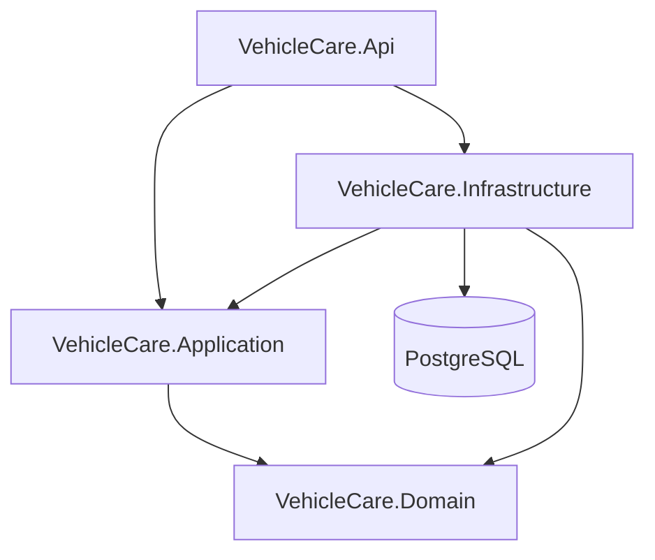

# Kiến trúc backend

Một API process, một PostgreSQL database; feature folder được thêm cùng use case đầu tiên:
Accounts, Vehicles, Entries, MaintenancePlans, Garage, Reports, Profile, Settings.

| Layer | Trách nhiệm | Không được làm |
|---|---|---|
| Domain | Entity, enum, ODO, lịch bảo dưỡng | Tham chiếu EF/HTTP/Identity |
| Application | Use case, DTO, validation, ports | Expose DbContext/IQueryable |
| Infrastructure | EF/migration, PostgreSQL, Identity, adapters | Tạo công thức nghiệp vụ khác domain |
| Api | Composition root, HTTP, middleware, health/OpenAPI | Chứa công thức ODO/chi phí/kế hoạch |

UnitTests tham chiếu Domain/Application; IntegrationTests tham chiếu Api/Infrastructure.
DatabaseTool tham chiếu Infrastructure để provision/check/smoke chủ đích.
Entity hiện là mutable data model; setter không thay cho validation/transaction trong use case.

## Dependencies

Pin version tại `be/Directory.Packages.props`, SDK tại `be/global.json`, EF tool tại `be/.config/dotnet-tools.json`.

| Project | Packages |
|---|---|
| Domain | Không có package ngoài framework |
| Application | FluentValidation; Microsoft.Extensions.DependencyInjection.Abstractions |
| Infrastructure | Microsoft.EntityFrameworkCore; Npgsql.EntityFrameworkCore.PostgreSQL; Microsoft.EntityFrameworkCore.Design (PrivateAssets); Microsoft.AspNetCore.Identity.EntityFrameworkCore |
| Api | Microsoft.AspNetCore.OpenApi; Scalar.AspNetCore; EF Design cho tooling |
| Tests | xunit; runner; Microsoft.NET.Test.Sdk; Microsoft.AspNetCore.Mvc.Testing; Testcontainers.PostgreSql |

Không thêm MediatR, AutoMapper, generic repository, scheduler hoặc broker ở nền tảng này.
Mapping DTO thủ công; port cụ thể thêm cùng use case. `IBusinessClock` đã có adapter Asia/Ho_Chi_Minh.

## Giai đoạn API tiếp theo

- Controller → application service → domain rules → persistence port; DI ở Api.
- Mutation khóa Account trong transaction, kiểm tra GarageRevision, tăng revision sau khi ghi.
- Identity và Account cùng ID, Identity chỉ nằm Infrastructure. Đăng ký tạo user/account/settings atomically.
- Cookie HttpOnly chứa ticket; AuthSession lưu protected ticket/session ID, hết hạn và thời điểm thu hồi. Identity stores được đăng ký qua EF; mỗi request kiểm tra session server-side.
- Persist Data Protection keys khi triển khai cookie, không commit key.
- Không lưu nguồn tính toán thứ hai cho ODO/tổng chi/hạn/trạng thái.
- Connection options validate lúc startup; DbContext resolve từ DI configuration cuối cùng. Logging console phù hợp container, không cần quyền Windows EventLog.

Tham khảo: [Microsoft support](https://dotnet.microsoft.com/en-us/platform/support/policy/dotnet-core),
[Npgsql EF10](https://www.npgsql.org/efcore/release-notes/10.0.html), [Scalar](https://scalar.com/docs-for/dotnet).
