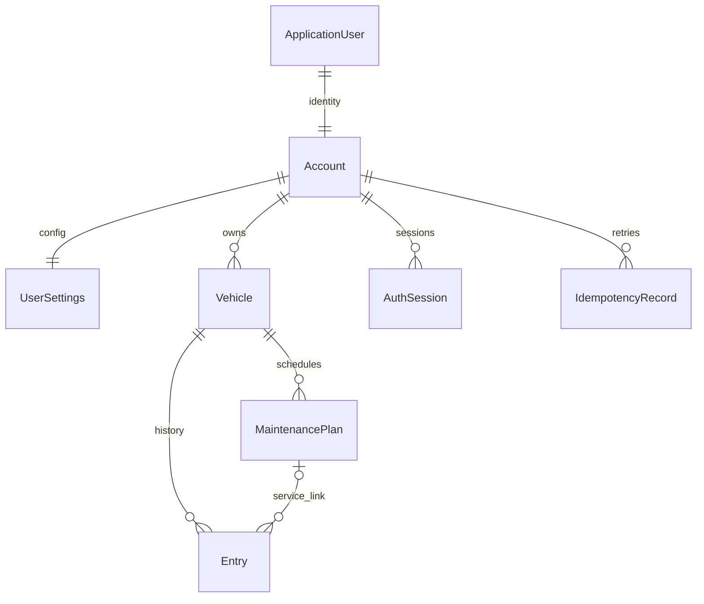

# Entity và database

## Property

Entity nghiệp vụ có CreatedAtUtc/UpdatedAtUtc; default chỉ khởi tạo lúc new object. Use case sau này phải cập nhật UpdatedAtUtc.

| Entity | Properties | Frontend |
|---|---|---|
| Account | Id:Guid, Name, Phone, GarageRevision:long | Account/profile; email từ Identity |
| UserSettings | AccountId PK, Reminders:bool=true, ThresholdKm:decimal=500, ThresholdDays:int=30 | Garage.settings |
| Vehicle | Id, AccountId, Name, Plate, PlateNormalized, Type:Car/Motorcycle, Year:int, BaseOdo:decimal, ImageUrl, ArchivedAtUtc? | Vehicle, image=ImageUrl; type Ô tô/Xe máy; archivedAt mở rộng |
| Entry | Id, AccountId, VehicleId, Kind:Fuel/Service/Odo, Title, Date:DateOnly, Odo/Cost/Liters:decimal, Note, PlanId:Guid? | Entry; kind fuel/service/odo |
| MaintenancePlan | Id, AccountId, VehicleId, Title, DueDate:DateOnly, DueOdo/IntervalKm:decimal, IntervalMonths:int | Plan; dueDate/dueOdo là hạn đầu |
| ApplicationUser | IdentityUser<Guid>: Email, NormalizedEmail, UserName, NormalizedUserName, PasswordHash, SecurityStamp, lockout... | Infrastructure; không lộ password hash |
| AuthSession | Id, AccountId, ProtectedTicket, CreatedAtUtc, ExpiresAtUtc, RevokedAtUtc? | Nền tảng phiên |
| IdempotencyRecord | AccountId+Key PK, RequestHash, ResponseStatus, ResponseBody, ResponseETag, CreatedAtUtc, ExpiresAtUtc | Nền tảng retry |

ID Guid server sinh, PostgreSQL uuid; JSON opaque string. Ngày date, audit timestamptz UTC.
decimal numeric(20,6); giữ cost phần lẻ form hiện cho phép, hiển thị VNĐ như frontend.
Precision dư reject trước DB (PostgreSQL numeric tự round nếu không validate).
Không lưu current ODO/tổng chi/trạng thái/hạn kế tiếp.

## Constraints và indexes

- Unique NormalizedEmail/UserName; Account FK Identity cùng ID; settings 1:1 Account.
- Unique vehicle (AccountId, PlateNormalized), kể cả archive. Normalization tương đương JS /\W/g (ASCII word, giữ underscore).
- Vehicle alternate key (AccountId, Id); plan alternate key (AccountId, VehicleId, Id).
- Entry/plan composite FK về vehicle; entry composite FK về plan bảo đảm cùng owner và xe.
- CHECK ODO/cost/liters, kind, plan chỉ service, interval/thresholds/type/year tối thiểu/revision.
- Index entries (AccountId,VehicleId,Date,Odo), (AccountId,PlanId,Date,Odo); plans owner/vehicle; session/idempotency expiry.
- Delete plan unlink entry trước trong transaction, FK NoAction; không composite SET NULL vì sẽ null owner/vehicle.
- Delete xe cascade entries/plans. Archive và ODO liên bản ghi là application/domain checks trong transaction, không DB trigger.
- Ngày tương lai, year tối đa động, trim/title/phone và precision được enforce ở use case khi bổ sung API, không tuyên bố DB đã kiểm tra hết.

## Migrations

Migration nằm Infrastructure. `scripts/be.ps1 migration -Name <Name>` tạo; `migrate` áp dụng chủ đích.
Không EnsureCreated ở runtime/test; không seed demo.
Trước schema change: review SQL, backup database có dữ liệu, test trên database riêng.
Rollback bằng EF database update migration trước chỉ sau review data loss; rollback initial xóa bảng, không chạy tùy tiện trên NAS.
