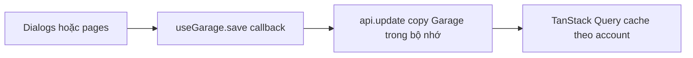
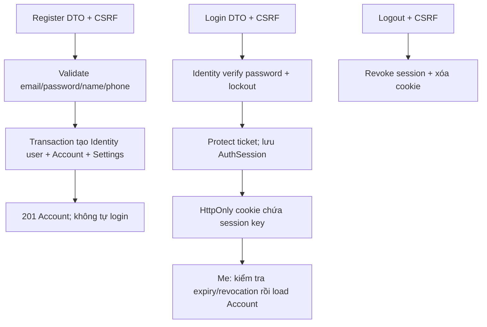
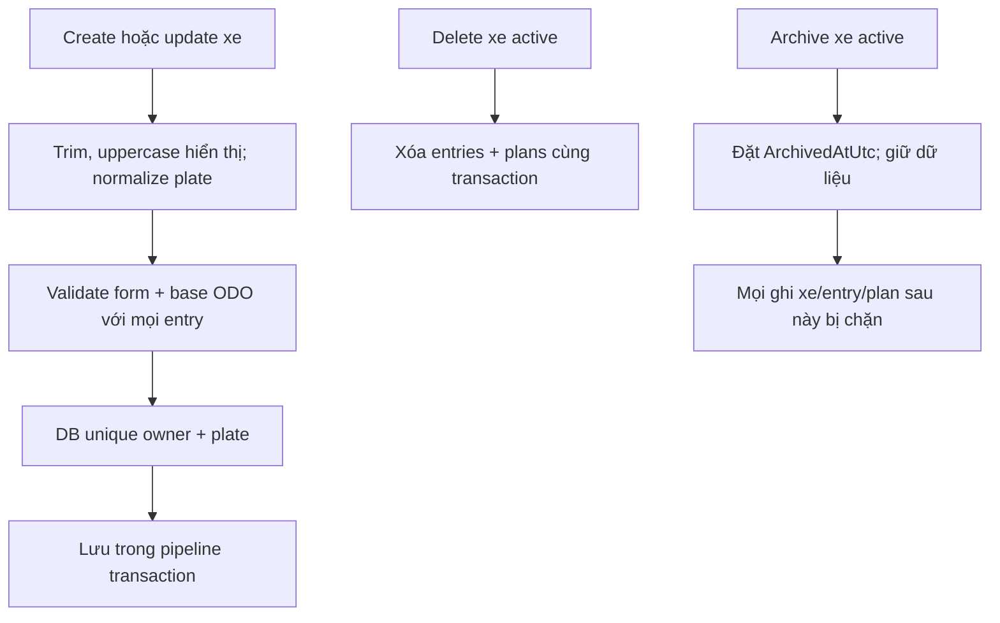
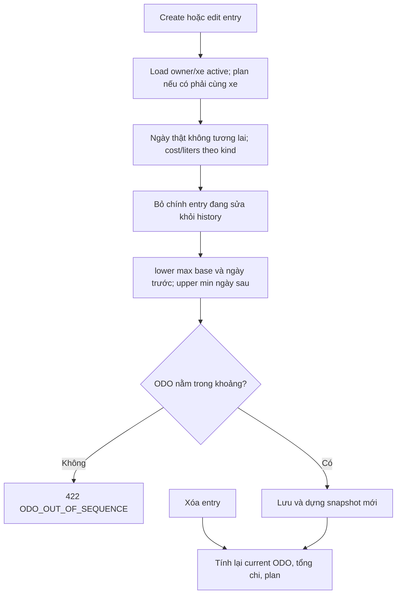
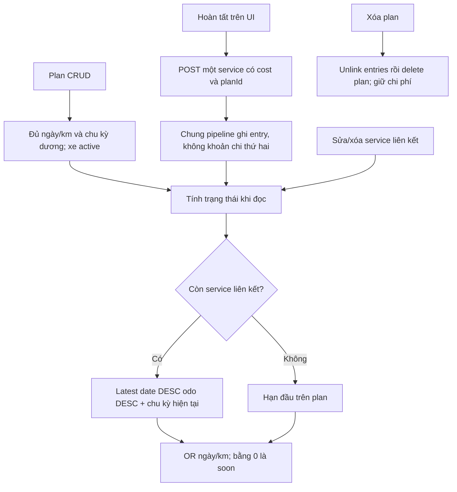
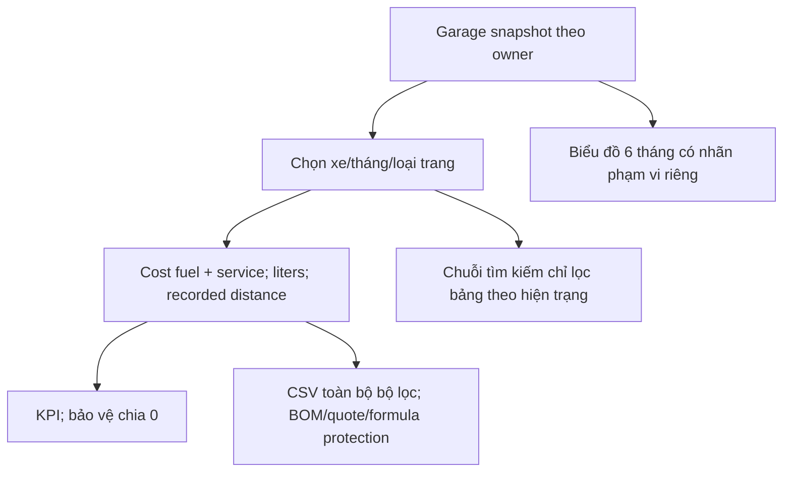

# Flow code tính năng

Các sơ đồ backend dưới đây là thiết kế, chưa có business HTTP endpoints. Domain ODO/plan đã có code.
Nguồn frontend hiện tại: `fe/src/store.tsx`, `data.ts`, `Dialogs.tsx`, `pages.tsx`.

## Hiện tại và đích



Hiện login gọi mock api.login; get(null) lấy dữ liệu demo. Không dùng cách preview này với database thật.
Đích sau này: thay callback bằng DTO JSON qua adapter HTTP, giữ useGarage và query cache; không gửi/eval callback hoặc upload Garage để overwrite.

## Pipeline ghi chung

```mermaid
sequenceDiagram
    actor User
    participant HTTP as Controller
    participant UC as Application use case
    participant Rules as Domain rules
    participant DB as PostgreSQL
    User->>HTTP: Cookie + CSRF + DTO + If-Match
    HTTP->>UC: Owner đáng tin cậy + command
    UC->>DB: Begin transaction; lock Account
    UC->>DB: Replay idempotency nếu có; check revision
    UC->>DB: Load target theo owner và quan hệ
    UC->>Rules: Archive + input + bất biến
    alt Sai rule, stale revision hoặc khác owner
        UC->>DB: Rollback
        UC-->>HTTP: Lỗi có code
    else Hợp lệ
        UC->>DB: Persist; tăng revision; tạo snapshot/ETag
        UC->>DB: Lưu idempotency response trong cùng transaction
        UC->>DB: Commit
        UC-->>HTTP: Garage + ETag
    end
    HTTP-->>User: JSON hoặc lỗi tiếng Việt
```

Đọc snapshot phải nhất quán revision/data. Mọi admin/import/job tương lai phải đi qua cùng rules.
Rollback toàn bộ khi bất kỳ bước nào lỗi; không xử lý ODO bằng snapshot stale ngoài transaction.

## FR-01: Tài khoản và phiên



Email trùng=409; thông báo login sai chung; không log password/ticket. Logout không xóa nghiệp vụ.
FE phải xóa cache cá nhân khi logout/401; không đưa dữ liệu account thật vào public preview.

## FR-02/03: Xe và archive



Khác owner=404; trùng plate kể cả archive=409; archive=403 khi cố ghi. Không restore.
Xóa plan của xe archive cũng bị chặn, không chỉ ẩn nút frontend.

## FR-04: Entry CRUD và ODO



Cùng ngày được khác ODO, không dùng thứ tự nhập. Sửa/xóa lớn nhất có thể giảm ODO hiện tại.
Ngày nghiệp vụ từ clock VN; entryId không được dùng để bỏ qua entry khác owner/xe.
POST dùng idempotency để retry không nhân chi phí; việc kiểm tra plan phải lặp lại ở server.

## FR-05/06: Kế hoạch và hoàn tất



Cộng tháng clamp cuối tháng; sửa interval tính lại từ latest service với interval mới.
Tắt reminders không đổi trạng thái; nhắc hạn bỏ xe archive. Không scheduler/email khi web đóng.

## FR-07/08: Dashboard, lịch sử, báo cáo/CSV



Quãng đường kỳ = max ODO trong kỳ - max ODO trước kỳ/base, min 0; không entry trong kỳ=0.
Đơn giá nhiên liệu=tổng tiền fuel/tổng lít, không lít/100km. Archive giữ lịch sử cho báo cáo.
Nếu phân trang server về sau, CSV/tổng không được chỉ tính trang đang hiển thị.

## FR-09: Profile/settings

PATCH profile allowlist name/phone, email bất biến; PATCH settings validate thresholds, không xóa kế hoạch.
Cả hai dùng owner/revision transaction như pipeline chung; thành công trả snapshot mới.
Không thay profile email bằng giá trị client để suy owner. Invalid input=422, stale=412.

## Thứ tự triển khai tiếp

Auth/session/CSRF → Garage snapshot/revision pipeline → xe/archive → entry/idempotency → plan → profile/settings → query/report helpers → HTTP adapter frontend.
Mỗi bước cập nhật FR, contract/flow và test trong cùng thay đổi; không cần refactor toàn bộ frontend trước khi backend sẵn sàng.
