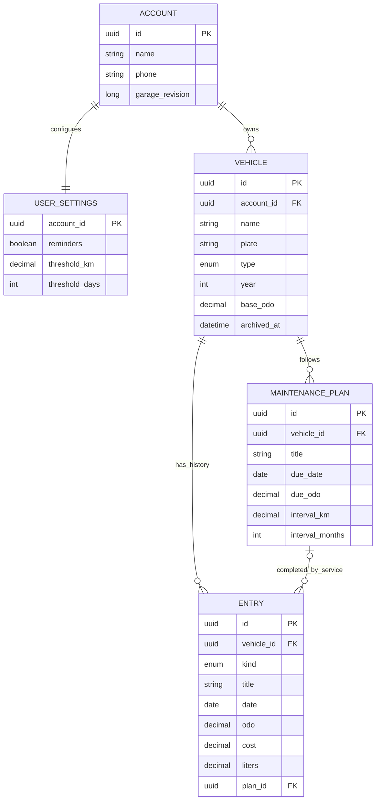
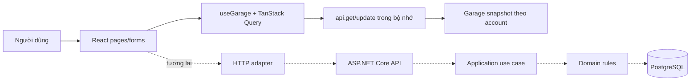
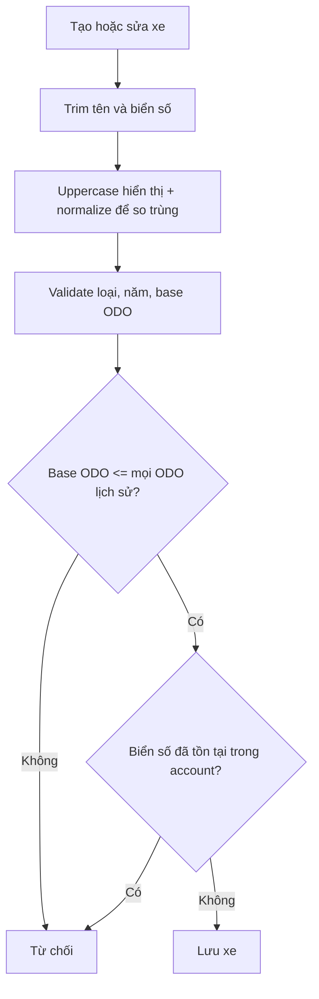
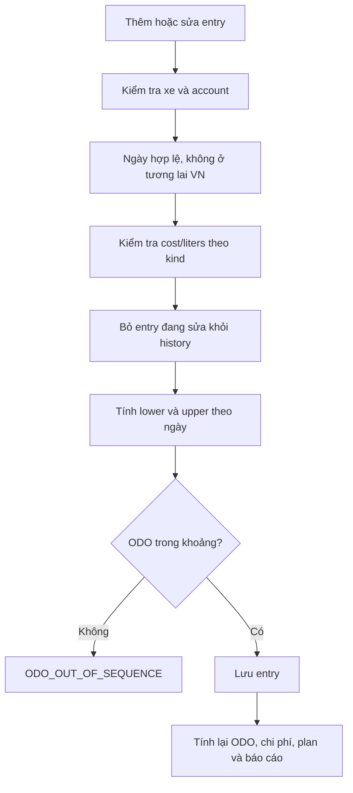
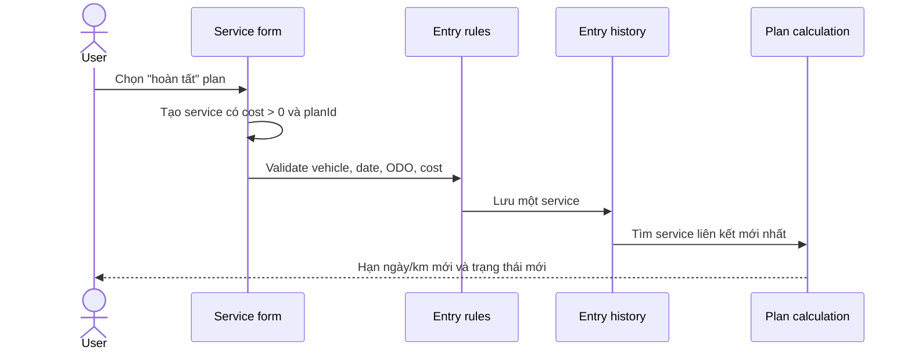
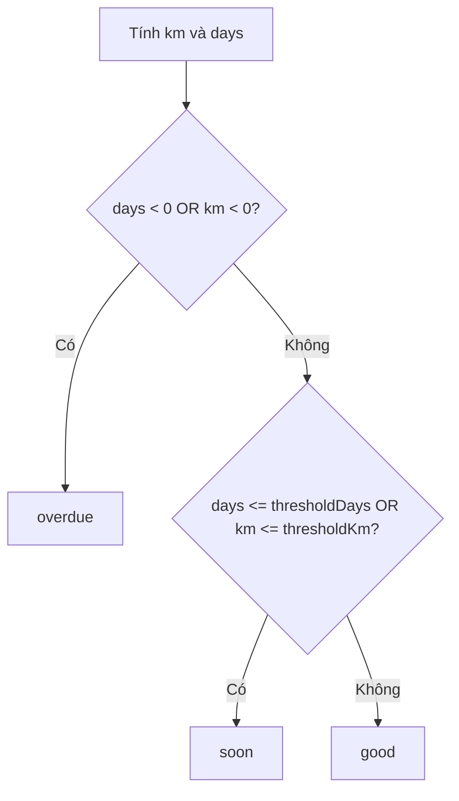

# VehicleCare — Domain Know-How

> Tài liệu nghiệp vụ tổng hợp cho developer, tester và người tiếp quản dự án.
> Nguồn chuẩn là code hiện tại và bộ tài liệu `doc/.be`. Những phần chưa có HTTP
> use case được ghi rõ là **thiết kế**, không phải chức năng đã triển khai.

## 1. Đọc nhanh

VehicleCare là ứng dụng quản lý garage cá nhân. Người dùng theo dõi nhiều ô tô
hoặc xe máy, ghi nhận ODO, nhiên liệu, bảo dưỡng/sửa chữa, lập kế hoạch bảo
dưỡng và xem chi phí theo xe hoặc theo tháng.

Trung tâm của miền nghiệp vụ là **một timeline ODO chung cho mỗi xe**. Nhiên
liệu, dịch vụ và cập nhật ODO đều là `Entry` trên timeline đó. Từ timeline,
hệ thống suy ra ODO hiện tại, quãng đường ghi nhận, trạng thái kế hoạch và các
chỉ số chi phí.

### Trạng thái triển khai

| Nhãn | Ý nghĩa |
|---|---|
| **Đã chạy — frontend mock** | Có thể thao tác trong React; dữ liệu nằm trong bộ nhớ của tab. |
| **Đã có domain/schema** | Backend đã có entity, rule, mapping hoặc migration; chưa đồng nghĩa có API. |
| **Thiết kế** | Có contract/flow dự kiến nhưng chưa có use case HTTP hoàn chỉnh. |
| **Chưa có** | Chưa tồn tại trong project, không được mô tả như một capability. |

### Phạm vi hiện tại

- Frontend nằm trong `fe/`, dùng React/Vite và mock API trong bộ nhớ.
- Backend nằm trong `be/`, dùng ASP.NET Core 10, Clean Architecture, EF Core và
  PostgreSQL. Backend hiện có nền tảng, domain rules, migration, health check và
  OpenAPI/Scalar; chưa có business API và chưa nối với frontend.
- Ngày nghiệp vụ dùng múi giờ `Asia/Ho_Chi_Minh`, lưu dạng `YYYY-MM-DD`; giao
  diện hiển thị `dd/MM/yyyy`.
- Tiền là VNĐ, quãng đường là km, nhiên liệu là lít.
- Không có GPS, telemetry, email, SMS, push notification hoặc scheduler nền.

### Ma trận yêu cầu

| Requirement | Nghiệp vụ trong tài liệu | Trạng thái tổng quát |
|---|---|---|
| FR-01 | Register/login/me/logout | Model nền, chưa có business API |
| FR-02 | Vehicle CRUD | Frontend mock; entity/schema backend |
| FR-03 | Archive xe | Domain property/guard; chưa có workflow API |
| FR-04 | Fuel/service/ODO | Frontend mock; domain rule/schema |
| FR-05 | Kế hoạch và trạng thái đến hạn | Frontend mock; domain rule |
| FR-06 | Hoàn tất kế hoạch bằng service | Frontend mock; domain calculation |
| FR-07 | Dashboard/history/filter | Frontend mock, chưa có query API |
| FR-08 | Report/CSV | Frontend mock, chưa có report API |
| FR-09 | Profile/settings | Frontend mock; entity/schema backend |
| FR-10 | Ownership/transaction/revision/idempotency | Thiết kế và metadata nền, chưa orchestration |
| FR-11 | Build/migration/health/OpenAPI/Scalar | Nền tảng backend đã có |

## 2. Bản đồ miền nghiệp vụ



### Luồng hiện tại và luồng đích



**Hiện tại:** form gọi `save(callback)`, callback sửa bản sao `Garage`, sau đó
mock store thay thế dữ liệu trong bộ nhớ. Reload trang sẽ tạo lại seed và mất
phiên/thay đổi.

**Đích backend:** request JSON phải đi qua ownership, validation, transaction,
revision và idempotency trước khi lưu database. Không gửi callback JavaScript,
không cho client ghi đè toàn bộ `Garage`.

## 3. Mô hình dữ liệu

### Account và settings

`Account` là chủ sở hữu của toàn bộ garage. Mọi vehicle, entry và plan phải
thuộc cùng account. Frontend hiện dùng `Account.id` để chọn kho mock; backend
sẽ suy account từ session đáng tin cậy, không tin `userId` do client gửi.

`UserSettings` chứa:

- `reminders`: bật/tắt số nhắc trên giao diện.
- `thresholdKm`: ngưỡng km để trạng thái chuyển sang `soon`, mặc định 500.
- `thresholdDays`: ngưỡng ngày để trạng thái chuyển sang `soon`, mặc định 30.

Tắt `reminders` chỉ ẩn badge/số lượng nhắc trên điều hướng. Nó không xóa plan,
không đổi công thức trạng thái và không gửi thông báo nền.

### Vehicle

| Trường | Ý nghĩa nghiệp vụ |
|---|---|
| `name` | Tên hiển thị của xe. |
| `plate` | Biển số hiển thị, được lưu dạng uppercase. |
| `plateNormalized` | Biển số dùng để kiểm tra trùng trong cùng account. |
| `type` | Chỉ có `Ô tô`/`Car` hoặc `Xe máy`/`Motorcycle`. |
| `year` | Năm sản xuất. |
| `baseOdo` | ODO tại thời điểm bắt đầu theo dõi. |
| `image`/`imageUrl` | Ảnh minh họa, không ảnh hưởng tính toán. |
| `archivedAtUtc` | Cờ lưu trữ backend đã model hóa; workflow archive chưa có API frontend. |

`baseOdo` là mốc thấp nhất của timeline. Khi sửa xe, không được đặt
`baseOdo` cao hơn bất kỳ ODO nào trong lịch sử.

### Entry

Mỗi `Entry` thuộc đúng một vehicle và có một trong ba loại:

| `kind` | Ý nghĩa | `cost` | `liters` | `planId` |
|---|---|---:|---:|---|
| `fuel` | Đổ nhiên liệu | > 0 | > 0 | Không dùng |
| `service` | Bảo dưỡng hoặc sửa chữa | > 0 | = 0 | Có thể liên kết plan |
| `odo` | Cập nhật ODO thuần | = 0 | = 0 | Không dùng |

Bảo dưỡng và sửa chữa hiện dùng chung `service`; chưa có taxonomy chi tiết hơn.
`planId` trên service là cách biểu diễn việc hoàn tất kế hoạch, không tạo thêm
một khoản chi phí thứ hai.

### MaintenancePlan

Một plan có hai điều kiện đến hạn cùng tồn tại:

- `dueDate`/`dueOdo`: hạn đầu tiên.
- `intervalMonths`/`intervalKm`: chu kỳ sau mỗi lần hoàn tất.

Plan luôn yêu cầu cả ngày và km. Không dùng giá trị 0 để biểu thị “tắt” một
điều kiện.

### Dữ liệu suy ra

Các giá trị sau không phải nguồn dữ liệu lưu riêng:

- `currentOdo = max(baseOdo, tất cả entry.odo của xe)`.
- Tổng chi phí = tổng `cost` của fuel và service trong phạm vi lọc.
- Hạn tiếp theo và trạng thái plan được tính từ plan, service liên kết gần nhất,
  current ODO, ngày hiện tại và settings.
- Quãng đường là quãng đường **ghi nhận từ ODO**, không phải số đo GPS.

## 4. Nghiệp vụ tài khoản và phạm vi dữ liệu

### Frontend hiện tại — đã chạy bằng mock

Có hai account demo:

- Nguyễn Minh Anh: `minhanh@vehiclecare.vn`.
- Trần Hoàng Nam: `hoangnam@vehiclecare.vn`.

Cả hai dùng cùng mật khẩu demo trong môi trường prototype. `api.login()` chỉ
xác thực hai account cố định. `api.get()` và `api.update()` chọn kho theo
account id; kết quả được clone để component không sửa trực tiếp store.

Guest có thể xem dữ liệu preview. Mọi thao tác ghi sẽ mở modal login. Logout
chỉ bỏ session hiện tại; dữ liệu mock trong tab vẫn còn cho tới khi reload.

### Backend đích — thiết kế, chưa có API

Thiết kế backend dự kiến có register, login, me và logout:

1. Register tạo Identity user, Account và Settings trong cùng transaction.
2. Login xác thực mật khẩu, tạo session server và cookie HttpOnly.
3. Me kiểm tra session chưa hết hạn/chưa bị revoke.
4. Logout revoke session và xóa cookie; không xóa nghiệp vụ.
5. Mọi query/mutation scope theo account lấy từ session.

Không dùng mật khẩu demo, localStorage token hoặc email client để suy quyền
trong production.

## 5. Quản lý phương tiện

### Tạo và sửa xe

Luồng nghiệp vụ:



Biển số được chuẩn hóa theo quy tắc hiện tại: bỏ ký tự không thuộc ASCII word
và chuyển uppercase. Database backend có unique key theo
`(AccountId, PlateNormalized)`, kể cả xe đã archive.

Giới hạn form hiện tại:

- Tên xe: 2–60 ký tự sau trim.
- Biển số: 5–20 ký tự, gồm chữ, số, dấu chấm, gạch ngang và khoảng trắng.
- Loại: ô tô hoặc xe máy.
- Năm: từ 1980 đến năm hiện tại + 1.
- ODO: 0–9.999.999, tối đa 6 chữ số thập phân ở backend.

### Xóa xe

Frontend hiện có xóa vĩnh viễn và cảnh báo rõ: xóa xe đồng thời xóa toàn bộ
entry và plan của xe, không thể hoàn tác. Backend schema đã cấu hình cascade cho
quan hệ này.

### Archive

Archive khác delete:

- Giữ vehicle, lịch sử và kế hoạch.
- Chặn sửa/xóa xe đã archive.
- Chặn tạo/sửa/xóa entry và plan của xe đã archive.
- Báo cáo có thể giữ lịch sử archive; nhắc hạn phải bỏ xe archive theo thiết kế.
- Chưa có restore.

Backend đã có `ArchivedAtUtc` và `GarageRules.EnsureActive()`, nhưng chưa có
workflow/API archive hoàn chỉnh. Không coi nút xóa hiện tại là archive.

## 6. Timeline ODO và nhật ký

### Quy tắc ODO

Khi thêm hoặc sửa entry `E`, bỏ chính `E` cũ khỏi tập history rồi tính:

```text
lower = max(baseOdo, ODO của mọi entry có ngày < E.date)
upper = min(ODO của mọi entry có ngày > E.date)

lower <= E.odo <= upper
```

Nếu không có entry ở ngày sau thì không có `upper`. So sánh theo ngày, không theo
thứ tự nhập hay giờ giả lập. Nhiều entry trong cùng một ngày được phép có ODO
khác nhau, miễn vẫn nằm trong cận của các ngày trước/sau.



`currentOdo` có thể giảm sau khi xóa hoặc sửa entry đang có ODO lớn nhất. Không
được coi ODO là một counter chỉ tăng bất biến.

### Entry hợp lệ

- Xe phải tồn tại, thuộc account và đang active.
- Ngày phải có thật và không lớn hơn `today()` theo `Asia/Ho_Chi_Minh`.
- ODO phải hữu hạn, không âm, trong giới hạn và nhất quán với history.
- Fuel phải có cost và liters dương.
- Service phải có cost dương và liters bằng 0.
- ODO thuần phải có cost và liters bằng 0.
- Chỉ service cùng xe/cùng account mới được mang `planId`.

Frontend kiểm tra bằng Zod và `validateEntry()`. Backend domain kiểm tra lại
trong transaction; validation client không phải lớp bảo mật.

### Sửa và xóa nhật ký

- Sửa entry giữ id, loại và quan hệ theo contract hiện tại; phải kiểm tra lại
  toàn bộ timeline mới.
- Xóa entry không chỉ xóa một dòng: ODO hiện tại, tổng chi phí, quãng đường và
  trạng thái plan liên quan đều phải được tính lại.
- Xóa service đã hoàn tất có thể làm plan quay lại trạng thái overdue/soon.

## 7. Kế hoạch bảo dưỡng

### Tạo kế hoạch

Một plan hợp lệ cần:

- Vehicle active và thuộc account.
- Tiêu đề 2–100 ký tự.
- Ngày đến hạn hợp lệ.
- ODO đến hạn 1–9.999.999.
- Chu kỳ km 1–1.000.000.
- Chu kỳ tháng là số nguyên 1–120.

Form hiển thị rõ: plan đến hạn theo ngày hoặc km, điều kiện nào đến trước.

### Hoàn tất kế hoạch

Không có cờ `completed` và không tạo khoản chi riêng. Người dùng hoàn tất bằng
một Entry duy nhất:



Chi phí chỉ xuất hiện một lần trong history. Service liên kết gần nhất được
chọn theo:

1. `date` giảm dần.
2. Nếu cùng ngày, `odo` giảm dần.

Nếu còn service liên kết:

```text
dueDate = service.date + intervalMonths
 dueOdo = service.odo + intervalKm
```

Khi cộng tháng, ngày được clamp về ngày cuối tháng đích. Ví dụ
31/01/2026 + 1 tháng = 28/02/2026; năm nhuận dùng 29/02.

Nếu sửa interval, hạn được tính lại từ service mới nhất với interval mới. Nếu
xóa service mới nhất, hệ thống chọn service còn lại; nếu không còn service nào,
plan quay về `dueDate` và `dueOdo` ban đầu.

### Xóa kế hoạch

Xóa plan không xóa service hoặc chi phí đã ghi nhận. Hệ thống unlink `planId`
trên các entry liên quan rồi mới xóa plan. Backend phải thực hiện việc này
trong transaction vì foreign key composite không tự `SET NULL` an toàn.

## 8. Trạng thái nhắc bảo dưỡng

`planState()` trả về `dueDate`, `dueOdo`, `km`, `days` và `status`.

```text
km   = dueOdo - currentOdo
 days = số ngày từ hôm nay tới dueDate theo Asia/Ho_Chi_Minh
```



Các biên quan trọng:

- Chỉ cần một điều kiện âm là `overdue`.
- Khi đúng ngày hoặc đúng ODO (`days = 0` hoặc `km = 0`) thì là `soon`, không
  phải `overdue`.
- `soon` dùng OR, không dùng AND.
- Không có service liên kết thì dùng hạn đầu của plan.
- Frontend và backend đều có test cho month-end, latest service, OR và zero
  boundary.

## 9. Dashboard, lịch sử và báo cáo

### Bộ lọc

Các màn hình có thể lọc theo:

- Vehicle cụ thể hoặc tất cả vehicle.
- Tháng cụ thể hoặc toàn bộ thời gian.
- Loại entry trên trang nhiên liệu/bảo dưỡng/lịch sử.
- Search text chủ yếu lọc bảng hiển thị; không được mặc định nói rằng search
  làm thay đổi mọi KPI.

### KPI và công thức

**Tổng chi:**

```text
fuelCost = sum(cost của fuel trong phạm vi lọc)
serviceCost = sum(cost của service trong phạm vi lọc)
totalCost = fuelCost + serviceCost
```

Entry ODO không đóng góp chi phí. Service hoàn tất plan cũng chỉ được cộng một
lần.

**Quãng đường ghi nhận:**

- Toàn bộ thời gian: `max(ODO trong phạm vi) - baseOdo`.
- Một tháng: `max(ODO trong tháng) - max(baseOdo, ODO trước ngày đầu tháng)`.
- Mỗi vehicle tính riêng rồi cộng lại.
- Không có entry trong kỳ thì bằng 0.
- Kết quả không âm.

**Đơn giá nhiên liệu trung bình:**

```text
fuelCost / totalFuelLiters
```

Đây không phải mức tiêu hao lít/100 km. Các phép chia cho 0 phải được bảo vệ.

**Biểu đồ:** biểu đồ xu hướng có cửa sổ sáu tháng riêng; nhãn phải phản ánh
đúng phạm vi của biểu đồ, không lẫn với KPI đang lọc.

**CSV:** xuất dữ liệu theo bộ lọc, có BOM UTF-8, escape dấu nháy và ngày hiển
thị tiếng Việt. Khi chuyển sang dữ liệu người dùng thật, phải chống CSV formula
injection và không chỉ xuất trang đang phân trang.

## 10. Hồ sơ và cài đặt

Frontend cho phép sửa profile name/phone. Email hiện là định danh demo và chưa
có luồng sửa. Backend contract dự kiến chỉ cho `PATCH /profile` với name/phone,
không nhận email để suy owner.

Settings cho phép sửa:

- `reminders`.
- `thresholdKm`: 1–100.000.
- `thresholdDays`: 1–365.

Profile/settings phải được scope theo account, kiểm tra revision và lưu atomically
khi API thật được triển khai.

## 11. Invariants và lỗi nghiệp vụ

| Nhóm | Bất biến |
|---|---|
| Ownership | Account, vehicle, entry và plan phải cùng owner; quan hệ plan phải cùng xe. |
| Active vehicle | Archive chặn mọi ghi mới/sửa/xóa liên quan. |
| Plate | `plateNormalized` duy nhất trong một account, kể cả archive. |
| ODO | Không âm, trong giới hạn, không phá vỡ lower/upper timeline. |
| Date | DateOnly hợp lệ, không ở tương lai theo giờ Việt Nam. |
| Kind | Fuel/service/odo phải có cost và liters đúng loại. |
| Plan link | `planId` chỉ dành cho service cùng xe/cùng owner. |
| Derived data | Không lưu cạnh tranh current ODO, tổng chi, status hoặc hạn kế tiếp. |
| Delete plan | Unlink service trước, giữ lại history và cost. |
| Delete vehicle | Xe active xóa cascade entries/plans trong cùng transaction. |
| Precision | Decimal tối đa 6 chữ số thập phân; reject trước khi DB tự round. |
| Concurrency | Backend dùng GarageRevision/ETag/If-Match để tránh ghi đè snapshot cũ. |
| Retry | Entry POST dùng Idempotency-Key để retry không nhân chi phí. |
| Rollback | Mutation lỗi ở bất kỳ bước nào phải rollback toàn bộ. |

Các mã lỗi backend dự kiến gồm:

| Code | Ý nghĩa |
|---|---|
| `NOT_FOUND` | Không tìm thấy hoặc không thuộc owner hiện tại. |
| `VEHICLE_ARCHIVED` | Xe đã lưu trữ, không thể thay đổi. |
| `INVALID_DATE` | Ngày không hợp lệ hoặc ở tương lai. |
| `ODO_OUT_OF_SEQUENCE` | ODO không nhất quán với timeline. |
| `VALIDATION` | Field hoặc tổ hợp field không hợp lệ. |
| `409` | Trùng biển số hoặc xung đột idempotency. |
| `412` | Revision/ETag cũ. |
| `428` | Thiếu `If-Match`. |
| `401/403` | Chưa xác thực hoặc bị chặn bởi archive. |

Frontend hiện hiển thị lỗi tiếng Việt từ form/rule. Backend thật phải kiểm tra
lại mọi rule, không chỉ dựa vào client.

## 12. Trạng thái frontend và backend

| Nghiệp vụ | Frontend mock | Backend domain/schema | HTTP business API |
|---|---:|---:|---:|
| Login/logout demo | Đã chạy | Model Identity/session nền | Chưa có |
| Register thật | Chưa có | Có thiết kế | Chưa có |
| Vehicle CRUD | Đã chạy | Entity, FK, unique plate | Chưa có |
| Archive | Chưa có | Property và guard | Chưa có |
| Fuel/service/ODO | Đã chạy | Rule và DB check | Chưa có |
| ODO timeline | Đã chạy | `GarageRules` + unit test | Chưa có |
| Maintenance plan | Đã chạy | Rule và mapping | Chưa có |
| Complete plan | Đã chạy qua service + `planId` | Calculation + test | Chưa có |
| Dashboard/history | Đã chạy trên snapshot mock | Chưa có query use case | Chưa có |
| Report/CSV | Đã chạy ở frontend | Chưa có report API | Chưa có |
| Profile/settings | Đã chạy trong mock | Entity/mapping | Chưa có |
| Transaction/revision/idempotency | Mock clone/rollback callback | Metadata/schema nền | Chưa có orchestration |
| Health/OpenAPI/Scalar | Không áp dụng | Có backend | Đã có endpoint nền |

Backend `Program.cs` hiện mới map:

- `/health/live`.
- `/health/ready`.
- `/openapi/v1.json` trong Development.
- `/scalar/v1` trong Development.

Các route `/api/v1/...` trong [api-contracts.md](.be/api-contracts.md) là thiết
kế giai đoạn tiếp theo, chưa phải endpoint có thể gọi.

## 13. Tra cứu nhanh trong code

| Câu hỏi | Điểm bắt đầu |
|---|---|
| Model, seed và công thức frontend ở đâu? | [fe/src/data.ts](../fe/src/data.ts) |
| Form entry/xe/plan và xóa liên đới ở đâu? | [fe/src/Dialogs.tsx](../fe/src/Dialogs.tsx) |
| Session, query, mutation và toast ở đâu? | [fe/src/store.tsx](../fe/src/store.tsx) |
| Dashboard, pages, KPI và report ở đâu? | [fe/src/pages.tsx](../fe/src/pages.tsx) |
| Filter, chart, history table và CSV helper ở đâu? | [fe/src/components.tsx](../fe/src/components.tsx) |
| Route UI ở đâu? | [fe/src/app/routes.tsx](../fe/src/app/routes.tsx) |
| Frontend acceptance test ở đâu? | [fe/tests/data.test.ts](../fe/tests/data.test.ts) |
| Backend entity và enum ở đâu? | [be/src/VehicleCare.Domain/Entities.cs](../be/src/VehicleCare.Domain/Entities.cs) |
| Backend rule ODO/plan ở đâu? | [be/src/VehicleCare.Domain/GarageRules.cs](../be/src/VehicleCare.Domain/GarageRules.cs) |
| DB mapping/constraint/FK ở đâu? | [be/src/VehicleCare.Infrastructure/GarageDbContext.cs](../be/src/VehicleCare.Infrastructure/GarageDbContext.cs) |
| Backend domain test ở đâu? | [be/tests/VehicleCare.UnitTests/GarageRulesTests.cs](../be/tests/VehicleCare.UnitTests/GarageRulesTests.cs) |
| Database/host test ở đâu? | [be/tests/VehicleCare.IntegrationTests/DatabaseTests.cs](../be/tests/VehicleCare.IntegrationTests/DatabaseTests.cs) |

Tài liệu chi tiết hơn:

- [Backend README](.be/README.md).
- [Architecture](.be/architecture.md).
- [Requirements](.be/requirements.md).
- [Data model](.be/data-model.md).
- [Functional flows](.be/functional-flows.md).
- [API contracts](.be/api-contracts.md).
- [Testing](.be/testing.md).

## 14. Test coverage và kiểm chứng

Các test hiện có bảo vệ những điểm nghiệp vụ quan trọng:

- Hai account demo đăng nhập và không dùng chung dữ liệu.
- ODO kiểm tra cả ngày trước và ngày sau.
- Nhiều ODO khác nhau trong cùng ngày.
- Sửa entry loại chính nó khỏi tập đối chiếu.
- Xóa ODO lớn nhất làm giảm current ODO.
- Fuel/service/ODO có cost và liters đúng loại.
- Service liên kết plan chỉ cộng chi phí một lần.
- Sửa/xóa service làm tính lại plan.
- Cộng tháng cuối tháng và năm nhuận.
- Trạng thái dùng OR; đúng hạn là `soon`.
- Mock transaction lỗi không làm thay đổi store.
- Database kiểm tra plate unique, ownership FK, kind constraint, unlink plan và
  cascade delete vehicle.
- Host kiểm tra health, OpenAPI và Scalar.

Lệnh kiểm chứng frontend:

```powershell
pnpm exec tsc --noEmit
pnpm test
pnpm build
```

Lệnh kiểm chứng backend:

```powershell
powershell -NoProfile -ExecutionPolicy Bypass -File be/scripts/be.ps1 build
powershell -NoProfile -ExecutionPolicy Bypass -File be/scripts/be.ps1 test
```

Integration test PostgreSQL cần Docker. Không dùng database NAS cho test phá hủy.

## 15. Thứ tự triển khai backend được đề xuất

Khi chuyển từ mock sang hệ thống thật, nên giữ thứ tự sau:

1. Auth/session/CSRF và account isolation.
2. Garage snapshot, revision và ETag.
3. Vehicle CRUD và archive guard.
4. Entry CRUD, ODO validation và idempotency.
5. Maintenance plan và completion qua service.
6. Profile/settings.
7. Report/CSV helpers và adapter frontend.
8. Bổ sung concurrency, security và parity tests cho mọi đường ghi.

Mỗi use case mới phải cập nhật domain rule, application port/DTO, persistence,
HTTP contract, flow diagram, test và changelog. Không đưa công thức ODO, chi phí
hoặc trạng thái kế hoạch vào controller/API riêng lẻ.

## Nguồn chính

- [Tóm tắt project](../sumary.md).
- [Quy tắc nghiệp vụ](../rules.md).
- [Quy trình phát triển](../skill.md).
- [Backend requirements](.be/requirements.md).
- [Backend functional flows](.be/functional-flows.md).
